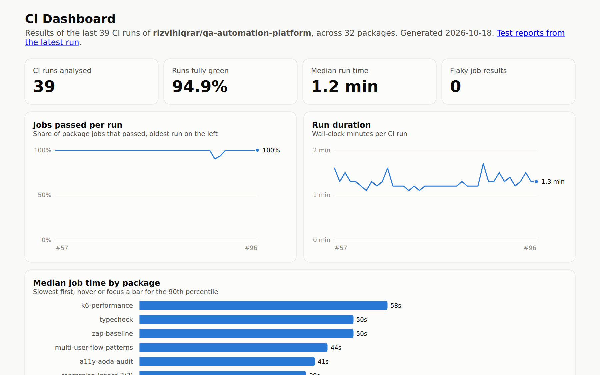
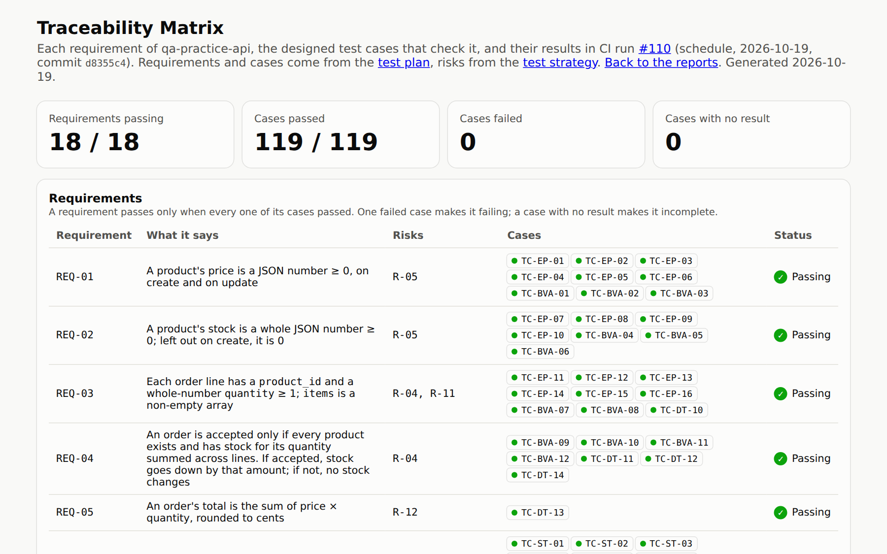
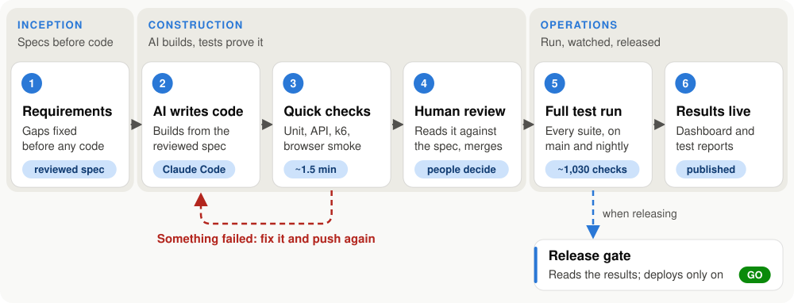

# Iqrar Rizvi

**QA Automation Engineer / SDET** · Playwright · TypeScript · API testing · CI/CD · Performance and security testing

QA Analyst with 2+ years in QA automation (Playwright, TypeScript, Azure DevOps, GitHub Actions, AI-assisted test generation), and 7+ years across support, training and QA, including bug replication and troubleshooting. I owned a 152-test Playwright regression suite running in Azure DevOps pipelines, with multi-environment validation, production deployments and the full defect lifecycle.

**Skills:** Test automation · Regression testing · Test cases · Defect tracking · API testing · Agile/Scrum · Playwright · Cypress · TypeScript · Python · k6 · Postman · SQL · GitHub Actions · Azure DevOps · Jira

I build automated tests that catch software bugs before customers do, and the pipelines that run those tests every time code changes. Based in the Greater Toronto Area; open to QA Automation and SDET roles, hybrid or remote across Canada. [Let's talk on LinkedIn](https://www.linkedin.com/in/iqrar-rizvi).

## Start here

- [**The CI dashboard**](https://rizvihiqrar.github.io/qa-automation-platform/) shows the live pass rate and run time of every test run.
- [**The AI-written-code scoreboard**](https://github.com/rizvihiqrar/qa-automation-platform/blob/main/docs/ai-written-code/scoreboard.md) shows which kind of test caught each mistake in AI-written code.
- [**A root-cause write-up**](https://github.com/rizvihiqrar/qa-automation-platform/blob/main/docs/rca/01-login-hashing-blocked-the-api.md) shows how I found why one login slowed down every other request.

**At a glance**

- **Week to hours.** In my current role, I turned a week-long manual regression process into an automated run of 1 to 3 hours.
- **Bugs found, then guarded.** Load testing found a login slowdown, and designed tests found 9 defects that the existing tests had passed. Every fix has a test that I watched fail with the bug put back.
- **Proof you can click.** About 1,570 automated checks run on every change and every night. The [live CI dashboard](https://rizvihiqrar.github.io/qa-automation-platform/), the [test reports](https://rizvihiqrar.github.io/qa-automation-platform/reports/) and the [traceability matrix](https://rizvihiqrar.github.io/qa-automation-platform/reports/traceability/) show the results, and each project opens with a plain-English summary.

### See it running

|  |  |
|---|---|
| **CI dashboard**: pass rate, run time and flaky results across recent runs, rebuilt after every run | **Traceability matrix**: each API requirement, the cases that check it, and their latest result |

*A double click on Transfer in the banking UI. The Cypress log shows one request, and the money moves once. The recording is slowed down about 5 times so each step can be seen.*

---

## Key projects

| Project | What it is | Checks |
|---|---|---:|
| [**qa-automation-platform**](https://github.com/rizvihiqrar/qa-automation-platform) | My main project: 29 testing tools and test suites in one repository, with one CI pipeline. Browser and API tests, performance and security testing, test design, SQL data checks, and AI-assisted testing, each with its own README and results. | ~1,570 |
| [cicd-pipeline-demo](https://github.com/rizvihiqrar/cicd-pipeline-demo) | One small API delivered by the same pipeline on GitHub Actions, GitLab CI and Azure DevOps: code checks, unit and integration tests, and a deployment step that needs approval. | 56 |

Three earlier suites ([accessibility](https://github.com/rizvihiqrar/accessibility-test-suite), [Playwright end-to-end](https://github.com/rizvihiqrar/playwright-demo-suite), [API](https://github.com/rizvihiqrar/api-test-suite)) are archived. Their work continues, in more depth, inside the main project.

---

## Selected results

- **A performance bug found by load testing.** Load testing showed every login froze the API for about 70 ms. I moved password hashing off the main thread, and browsing p95 dropped from 67 ms to 1 ms. ([details](https://github.com/rizvihiqrar/qa-automation-platform/blob/main/docs/rca/01-login-hashing-blocked-the-api.md))
- **AI-written code, tested like code from an unknown author.** An AI wrote a discount-code feature, and the 165 tests that already existed missed all 7 of its mistakes. A code review, designed tests and property-based tests found every one. ([details](https://github.com/rizvihiqrar/qa-automation-platform/blob/main/docs/ai-written-code/scoreboard.md))
- **A banking API where every cent is exact.** I count money in whole cents, so three deposits of 0.10 make exactly 0.30. A transfer sent twice with the same key moves the money once, even after a double click in the browser. ([details](https://github.com/rizvihiqrar/qa-automation-platform/tree/main/packages/banking-api))
- **AI-written tests, reviewed before they count.** 42 of 43 generated browser tests passed on their first run. My review step caught one test with no assertion that the test runner still reported as passing. ([details](https://github.com/rizvihiqrar/qa-automation-platform/tree/main/packages/ai-test-generator))
- **Test design that found what other tests missed.** Cases built with named test design techniques found 9 defects that the 38 existing tests had passed. One of them let a delivered order go back to pending. ([details](https://github.com/rizvihiqrar/qa-automation-platform/tree/main/docs/test-strategy))
- **Security testing of an API.** An access-control matrix showed that any customer could change product prices and read every account. I fixed both, and an OWASP ZAP scan now runs in CI. ([details](https://github.com/rizvihiqrar/qa-automation-platform/tree/main/packages/qa-practice-api#security-scan))

---

## How I work

<picture>
  <source media="(prefers-color-scheme: dark)" srcset="images/workflow-dark.svg">
  
</picture>

An AI-driven development lifecycle (AI-DLC): AI drafts and builds, people decide, and tests prove it.

- **AI drafts and people decide.** Requirements are reviewed before code is written. AI-written code is read against the spec, and designed tests decide whether it merges.
- **Every change goes through a pull request.** It merges only when CI is green.
- **Green is not proof.** Several checks here once passed while checking nothing, such as a test with no assertion that the runner still reported as passing. When I fix a bug, I put it back once to show that the new test fails.
- **I write it down.** Bugs get [root-cause write-ups](https://github.com/rizvihiqrar/qa-automation-platform/tree/main/docs/rca). Flaky tests get [statistics](https://github.com/rizvihiqrar/qa-automation-platform/tree/main/packages/flaky-test-analyzer#how-sure-are-we-run-to-run-variance) instead of guesses. Each project says what it doesn't cover yet.

---

## What I do

- **Automated testing** of web apps and APIs (Playwright, BDD with Cucumber, API contract checks against OpenAPI, and Python with pytest)
- **CI/CD pipelines** that run tests on every change and block a release with a clear reason when something fails
- **Performance testing** with k6, with pass/fail limits set from measurements
- **Security and accessibility testing**: access-control tests, OWASP ZAP, and WCAG/AODA audits with axe-core
- **Test design and analysis**: test strategies, test plans, traceability, requirement reviews, root-cause analysis
- **SQL data checks** that find records that don't add up and list the exact rows
- **AI-assisted testing**: using AI to draft tests and code, then reviewing and testing what it produces

---

## Roadmap

| Item | Status | Link |
|---|---|---|
| Visual regression: screenshots of the banking UI in light, dark and phone width, with planted visual bugs the comparison must catch (October 2026) | Done | [packages/visual-regression-demo](https://github.com/rizvihiqrar/qa-automation-platform/tree/main/packages/visual-regression-demo) |
| Synthetic monitoring: a real browser checks four public sites every 30 minutes, with 30 days of uptime and load-time history on the dashboard and a GitHub issue that opens and closes itself (October 2026) | Done | [packages/synthetic-monitor](https://github.com/rizvihiqrar/qa-automation-platform/tree/main/packages/synthetic-monitor) |
| Course: Testing money in software, with a quiz for each objective and a hands-on practical (built; the pilot is next) | Building | [packages/money-course](https://github.com/rizvihiqrar/qa-automation-platform/tree/main/packages/money-course) |
| The banking API's ledger on Postgres in Docker | Planned | |
| Observability: OpenTelemetry traces from the practice API, with tests that assert on them | Planned | |

---

## Tools I use

**Testing:** Playwright, Cypress, pytest, TypeScript, JavaScript, Python, Jest, Cucumber (BDD), k6, Postman, Pact (contract testing), fast-check (property-based testing), Stryker (mutation testing), axe-core, OWASP ZAP

**Pipelines:** GitHub Actions, Azure DevOps, GitLab CI

**Other:** Node.js, REST APIs, OpenAPI, SQL, Jira, Git

---

## Contact

- LinkedIn: [linkedin.com/in/iqrar-rizvi](https://www.linkedin.com/in/iqrar-rizvi)
- Open to messages here on GitHub or on LinkedIn
